<!-- ═══════════════════════════════════════════════════════════════════════════
     MedAssist 铭医 · GitHub 主页（v2.0）
     首屏：SMIL 动画 SVG（随系统深浅色切换），不是静态图。
     结构：视觉印象 → 30 秒判断 → 系统脉络 → 真实界面（全 50 张）→ 能力 → 上手 →
           可复核数字 → 已知边界。信息密度递增，读完仍能一句话复述。
     ═══════════════════════════════════════════════════════════════════════════ -->

<p align="center">
  <picture>
    <source media="(prefers-color-scheme: dark)"  srcset="docs/showcase/assets/hero-anim-dark.svg">
    <source media="(prefers-color-scheme: light)" srcset="docs/showcase/assets/hero-anim-light.svg">
    
  </picture>
</p>

<h3 align="center">医院里跑得起来的那一层，才是真系统</h3>

<p align="center">
  <sub>
    16 个独立领域服务 · 913 个 HTTP 端点 · 15 个 schema / 334 张表 · 312 个迁移<br/>
    从挂号到医保结算，从医嘱执行到危急值闭环，从主数据治理到 AI 循证问答
  </sub>
</p>

<p align="center">
  <a href="https://github.com/poincare-lijiashu/medical-agent/actions/workflows/ci.yml">
    
  </a>
  
  
  
  
  
</p>

<p align="center">
  
  
  
  
  
</p>

<p align="center">
  <a href="#-三十秒看懂"><b>三十秒看懂</b></a> ·
  <a href="#-一屏看懂系统脉络">系统脉络</a> ·
  <a href="#-架构">架构</a> ·
  <a href="#-界面50-张真实截图">界面（50 张）</a> ·
  <a href="#-能力矩阵">能力矩阵</a> ·
  <a href="#-十分钟跑起来">快速开始</a> ·
  <a href="#-我们没说谎的地方">已知边界</a> ·
  <a href="docs/showcase/index.html">完整展示站</a>
</p>

---

## ⏱ 三十秒看懂

大多数医疗系统停在"能建"，这个项目想解决的是"能跑、能查、能兜底"。

<table>
<tr>
<td width="33%" valign="top">

**它会拒绝启动**

开发默认密钥、默认口令、未绑定实例码的许可、
指向境外的模型端点 —— 任一条命中生产环境，
服务**直接拒绝启动**，而不是打条日志继续跑。

</td>
<td width="33%" valign="top">

**它会留下证据**

14 张审计表由数据库触发器强制只追加，
应用层改不动。谁在何时、从哪个 IP、
对哪条业务记录做了什么，可追溯到 traceId。

</td>
<td width="33%" valign="top">

**它会承认没做到**

医嘱还没有统一的 `EXECUTED` 回写，
姓名类字段仍是明文，16 个旧 E2E 用例仍挂着 skip。
这些写在[已知边界](#-我们没说谎的地方)，也写在评测报告里。

</td>
</tr>
</table>

> [!NOTE]
> 第三方评测综合分 **65.9 / 100**。我们没有把这个数字藏起来，也没有把未整改项从清单里删掉
> —— 完整报告与 30 项缺陷见 [docs/eval/2026-11-13/SUMMARY.md](docs/eval/2026-11-13/SUMMARY.md)。

---

## 🧭 一屏看懂系统脉络

不靠形容词。下面是**真实的服务拓扑**与**一条医嘱的完整旅程**，
GitHub 原生渲染（Mermaid），点开 `</>` 可直接读源码。

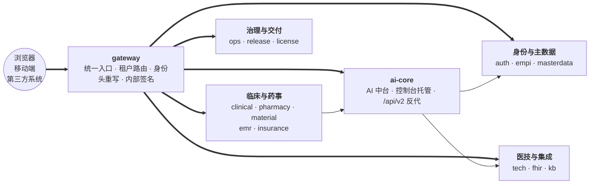

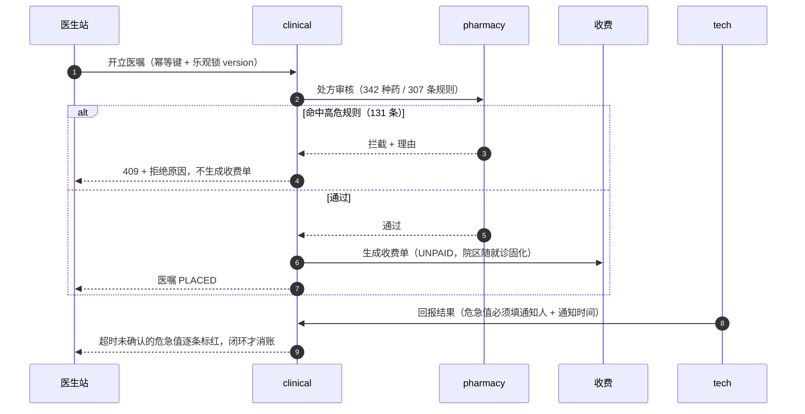

---

## 📐 架构

<p align="center">
  
</p>

**四个刻意的取舍**

| 取舍 | 原因 | 代价（我们认） |
|---|---|---|
| **按域拆 16 个服务，不做一个单体** | 每个域独立 schema + 独立 Flyway 历史，迁移互不阻塞；药房发药慢不会拖垮挂号 | 跨域查询要走 API 组合，不能一条 SQL 联表 |
| **控制台与 AI 中台同源（单端口）** | `/api/v2` 由中台反代到网关，浏览器只面对一个源；免 CORS、免两套登录 | 中台成为首跳，需要独立的连接池与超时策略 |
| **审计下沉到数据库触发器** | 应用层"自觉写审计"迟早会漏；触发器拒绝 `UPDATE/DELETE` | 审计表只增不减，需要定期归档策略 |
| **AI 只允许本地/国产模型** | 病历正文出境是合规红线；生产环境境外端点拒绝启动 | 可选模型范围变窄，需要院内 GPU 或国产 MaaS |

完整图集（7 张：上下文 / 服务地图 / 医嘱链路 / AI 链路 / 数据 / 部署 / 安全纵深）见
**[docs/architecture/ARCHITECTURE.md](docs/architecture/ARCHITECTURE.md)**。

---

## 🖥 界面（50 张真实截图）

> 全部 50 张都在下面，按业务域分组。**点任意一张看全尺寸原图**；
> 需要放大、键盘翻页、按域筛选，用 **[完整展示站](docs/showcase/index.html)**。


### 入口与总览（5）

<table>
<tr>
<td width="33%" valign="top" align="center"><a href="docs/showcase/screenshots/01-login.png" title="院内账号登录，httpOnly 会话令牌，登录即写审计">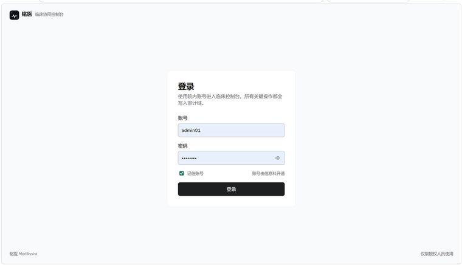</a><br/><sub><b>登录</b></sub></td>
<td width="33%" valign="top" align="center"><a href="docs/showcase/screenshots/02-ai-workbench.png" title="待复核 / 已处理 / 知识库 / 审计四维指标 + 六个能力入口">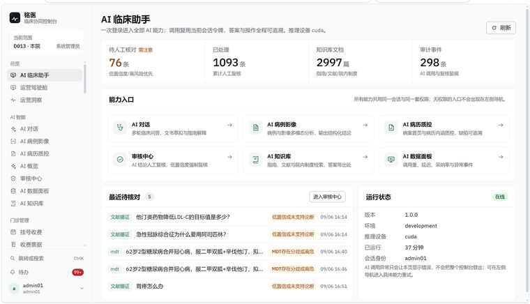</a><br/><sub><b>AI 临床助手总览</b></sub></td>
<td width="33%" valign="top" align="center"><a href="docs/showcase/screenshots/03-ops-cockpit.png" title="门诊挂号、实收、在院患者、待审处方、医技待办、耗材库存六大 KPI 与趋势">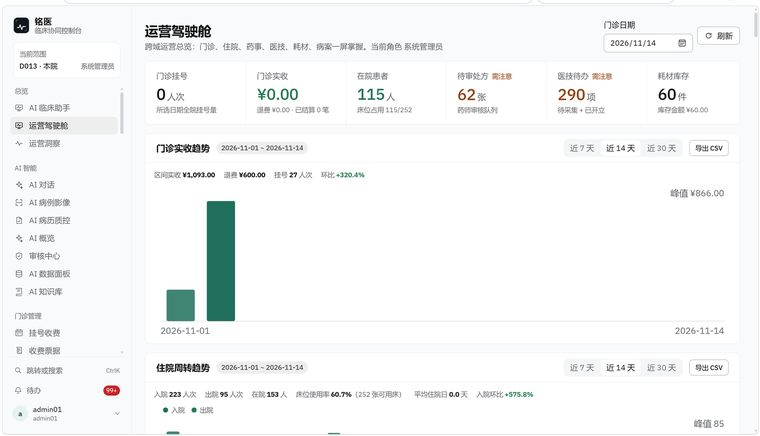</a><br/><sub><b>运营驾驶舱</b></sub></td>
</tr>
<tr>
<td width="33%" valign="top" align="center"><a href="docs/showcase/screenshots/04-ops-metrics.png" title="每日指标明细表 + 药事/物资趋势 + 门诊分账与住院周转">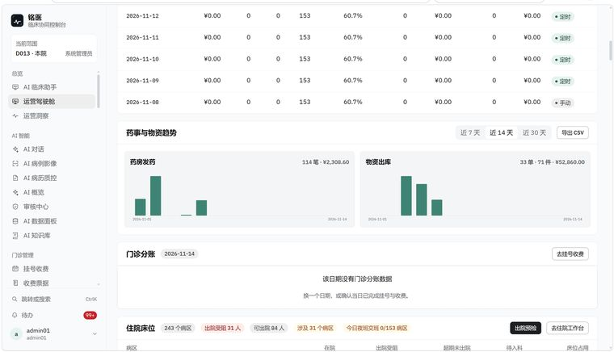</a><br/><sub><b>运营指标明细</b></sub></td>
<td width="33%" valign="top" align="center"><a href="docs/showcase/screenshots/05-ops-insight.png" title="同比科室 / 病区经营下钻，区间选择器下钻到病区">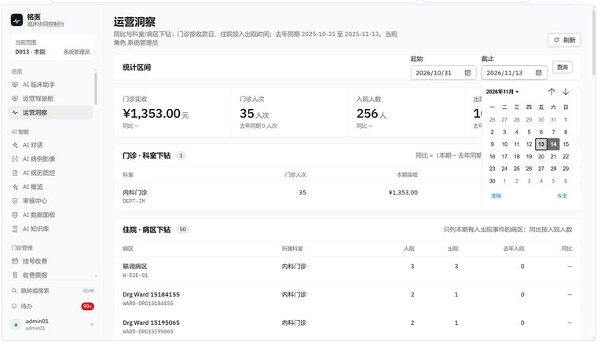</a><br/><sub><b>运营洞察下钻</b></sub></td>
<td width="33%"></td>
</tr>
</table>


### AI 中台与治理（16）

<table>
<tr>
<td width="33%" valign="top" align="center"><a href="docs/showcase/screenshots/10-ai-observability.png" title="待双人核对、已签发、已驳回、知识库、审计事件与运行时长">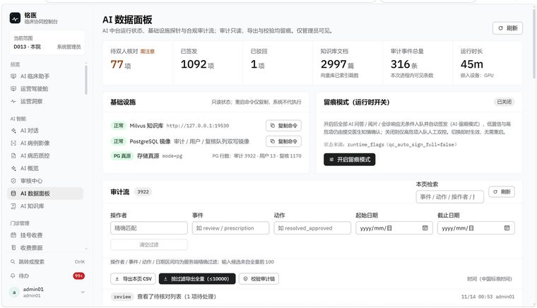</a><br/><sub><b>AI 运营看板</b></sub></td>
<td width="33%" valign="top" align="center"><a href="docs/showcase/screenshots/11-ai-audit.png" title="审计流水可按操作者/事件/动作检索并导出 CSV">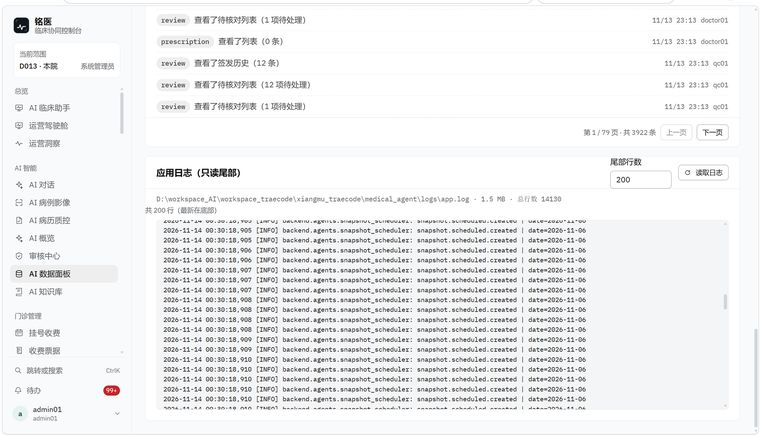</a><br/><sub><b>AI 审计与日志</b></sub></td>
<td width="33%" valign="top" align="center"><a href="docs/showcase/screenshots/12-ai-chat-agents.png" title="八大能力域智能体自动路由与示例问题">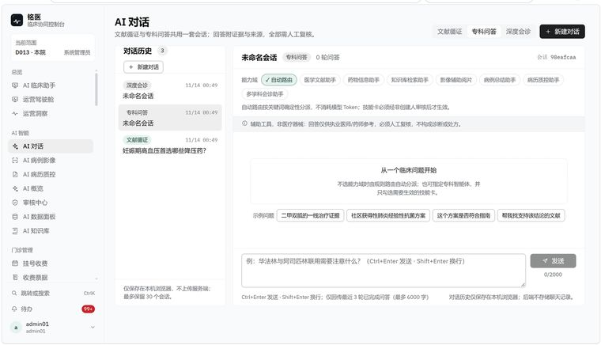</a><br/><sub><b>AI 对话 · 能力域路由</b></sub></td>
</tr>
<tr>
<td width="33%" valign="top" align="center"><a href="docs/showcase/screenshots/13-ai-chat-evidence.png" title="置信度 0.91、来源与证据链（妊娠期高血压诊治指南 2020）">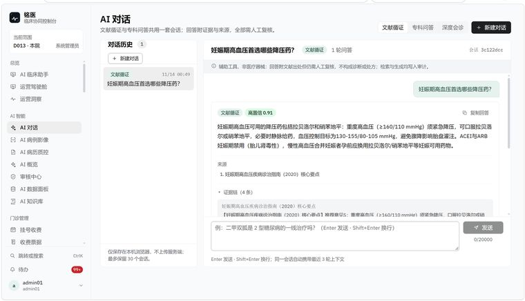</a><br/><sub><b>AI 对话 · 文献循证</b></sub></td>
<td width="33%" valign="top" align="center"><a href="docs/showcase/screenshots/14-ai-chat-multi.png" title="多轮会话 + 深度会诊/专科问答/文献循证三类标签">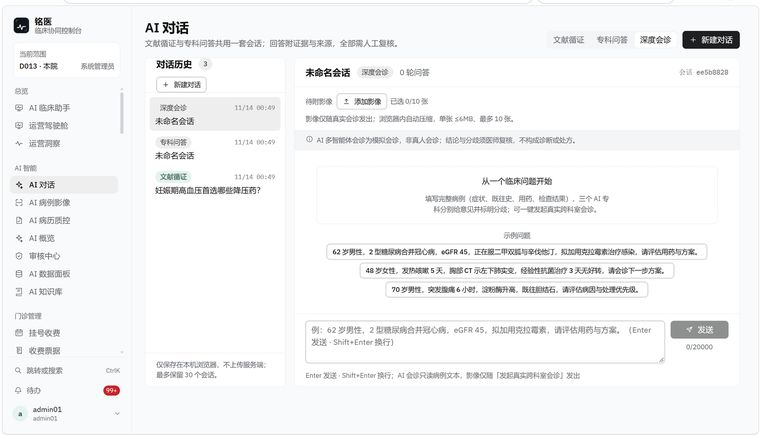</a><br/><sub><b>AI 对话 · 多轮问诊</b></sub></td>
<td width="33%" valign="top" align="center"><a href="docs/showcase/screenshots/15-ai-imaging.png" title="上传影像后生成结构化分析，必须人工复核后入审核队列">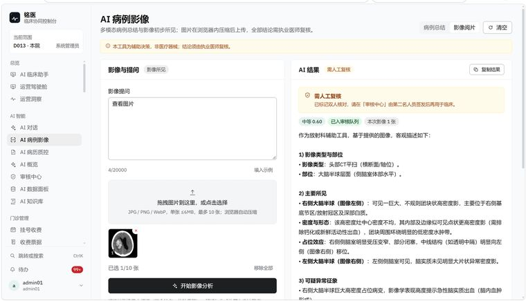</a><br/><sub><b>AI 病例影像</b></sub></td>
</tr>
<tr>
<td width="33%" valign="top" align="center"><a href="docs/showcase/screenshots/16-ai-qc.png" title="病历七栏自动拆分并输出质检结果，可跳审核中心">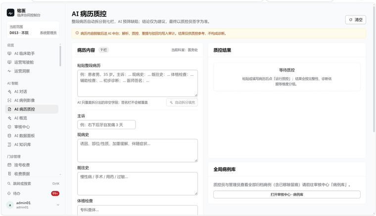</a><br/><sub><b>AI 病历质控</b></sub></td>
<td width="33%" valign="top" align="center"><a href="docs/showcase/screenshots/17-ai-agent-catalog.png" title="智能体目录 + 工具注册表 + 技能清单">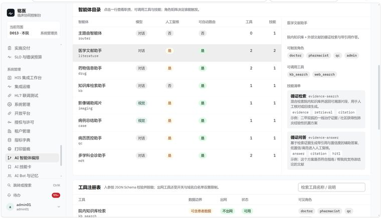</a><br/><sub><b>智能体编排</b></sub></td>
<td width="33%" valign="top" align="center"><a href="docs/showcase/screenshots/18-ai-agent-routing.png" title="能力开关、智能体、可用工具、合规模型与联网白名单计数">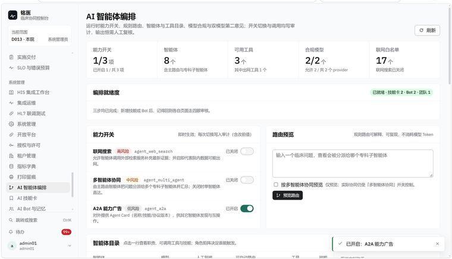</a><br/><sub><b>能力开关与路由</b></sub></td>
</tr>
<tr>
<td width="33%" valign="top" align="center"><a href="docs/showcase/screenshots/19-ai-model-compliance.png" title="模型分级结论 + 联网来源白名单 + 双模型第二意见复核">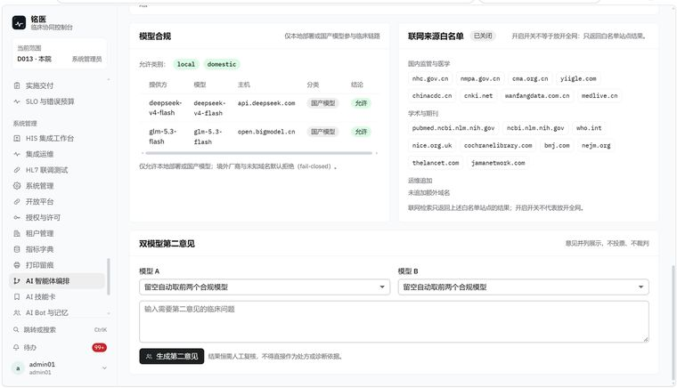</a><br/><sub><b>模型合规检查</b></sub></td>
<td width="33%" valign="top" align="center"><a href="docs/showcase/screenshots/20-ai-lab.png" title="记忆体检与有界工具循环沙盒">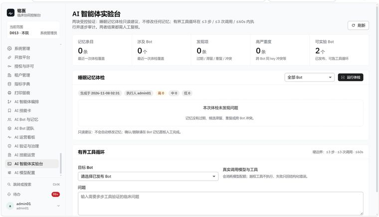</a><br/><sub><b>智能体实验台</b></sub></td>
<td width="33%" valign="top" align="center"><a href="docs/showcase/screenshots/21-ai-bot-memory.png" title="Bot 列表含能力域、模型绑定、版本、技能卡与记忆范围">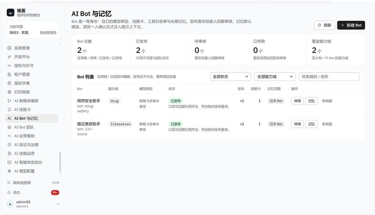</a><br/><sub><b>Bot 与记忆</b></sub></td>
</tr>
<tr>
<td width="33%" valign="top" align="center"><a href="docs/showcase/screenshots/22-ai-skillcards.png" title="高危联用拦截、指南优先裁决、病案首页缺陷分级三张卡">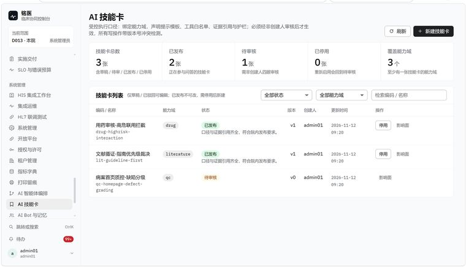</a><br/><sub><b>AI 技能卡</b></sub></td>
<td width="33%" valign="top" align="center"><a href="docs/showcase/screenshots/23-ai-model-config.png" title="模型注册表单 + 密钥加解密盘点（只统计 keyId，不含密钥材料）">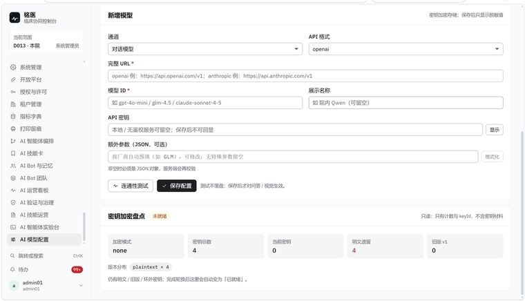</a><br/><sub><b>模型配置与密钥盘点</b></sub></td>
<td width="33%" valign="top" align="center"><a href="docs/showcase/screenshots/24-ai-command-palette.png" title="⌘K 直达任意页面，减少层级跳转">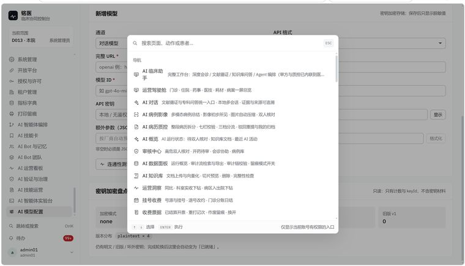</a><br/><sub><b>全局命令面板</b></sub></td>
</tr>
<tr>
<td width="33%" valign="top" align="center"><a href="docs/showcase/screenshots/25-ai-kb.png" title="指南文档上传向量化，2997 个向量片段可检索">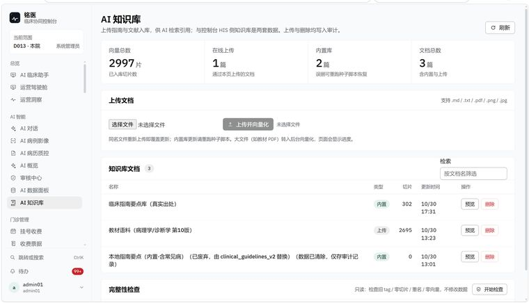</a><br/><sub><b>AI 知识库</b></sub></td>
<td width="33%"></td>
<td width="33%"></td>
</tr>
</table>


### 临床业务闭环（21）

<table>
<tr>
<td width="33%" valign="top" align="center"><a href="docs/showcase/screenshots/30-registration.png" title="按科室与日期挂号、导源、就诊记录与门诊日结">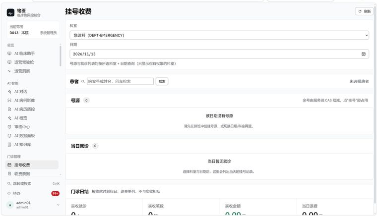</a><br/><sub><b>挂号收费</b></sub></td>
<td width="33%" valign="top" align="center"><a href="docs/showcase/screenshots/31-inpatient.png" title="病区在院患者、入院登记、床位看板与欠费预警">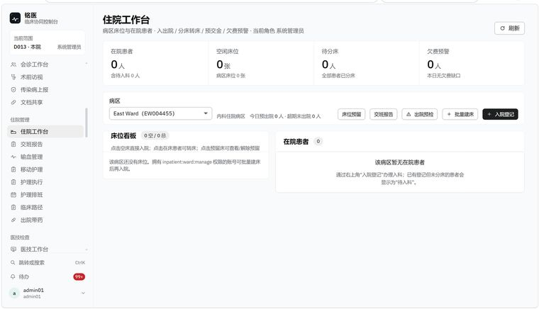</a><br/><sub><b>住院工作台</b></sub></td>
<td width="33%" valign="top" align="center"><a href="docs/showcase/screenshots/32-tech-workbench.png" title="待采集 / 待接收 / 执行中 / 危急值待闭环四态 + 检验申请队列">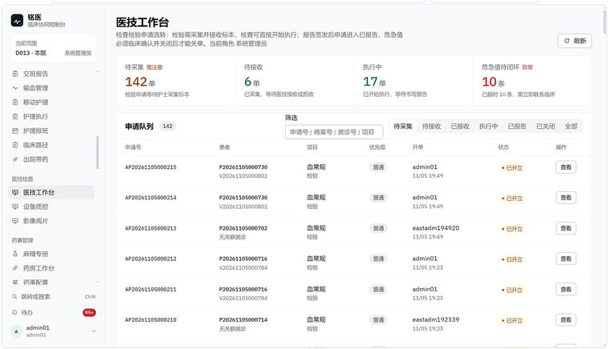</a><br/><sub><b>医护工作台</b></sub></td>
</tr>
<tr>
<td width="33%" valign="top" align="center"><a href="docs/showcase/screenshots/33-critical-value.png" title="血钾 6.8 mmol/L 等超时危急值逐条确认闭环">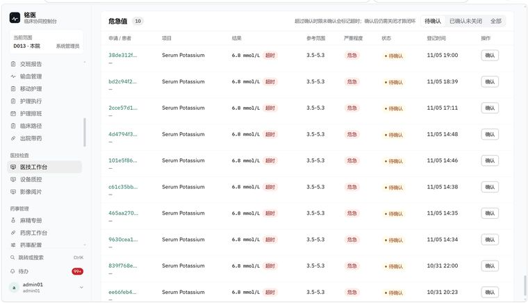</a><br/><sub><b>危急值闭环</b></sub></td>
<td width="33%" valign="top" align="center"><a href="docs/showcase/screenshots/34-pharmacy.png" title="处方审核、发药分拣、库存预警与计费状态">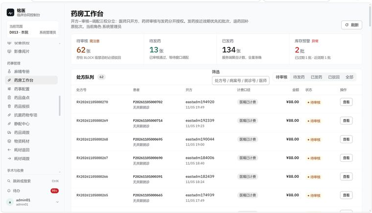</a><br/><sub><b>药房工作台</b></sub></td>
<td width="33%" valign="top" align="center"><a href="docs/showcase/screenshots/35-pharmacy-config.png" title="药品字典 342 种、相互作用规则 307 条（高危 131）">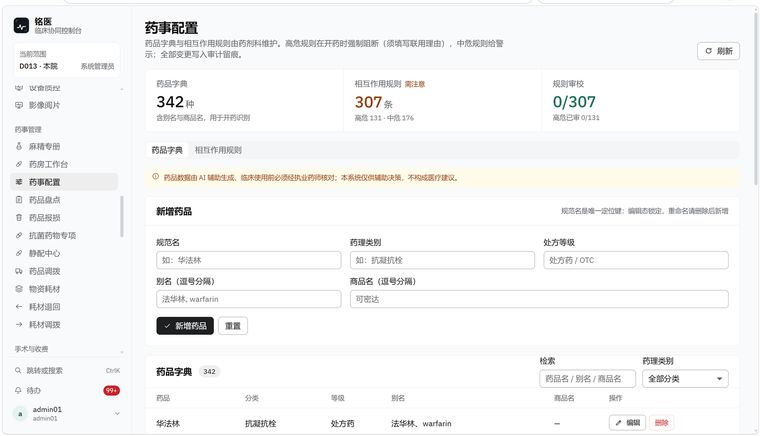</a><br/><sub><b>药事配置</b></sub></td>
</tr>
<tr>
<td width="33%" valign="top" align="center"><a href="docs/showcase/screenshots/36-review-center.png" title="AI 高风险结论二人复核：待核对 77 / 开药待审 7">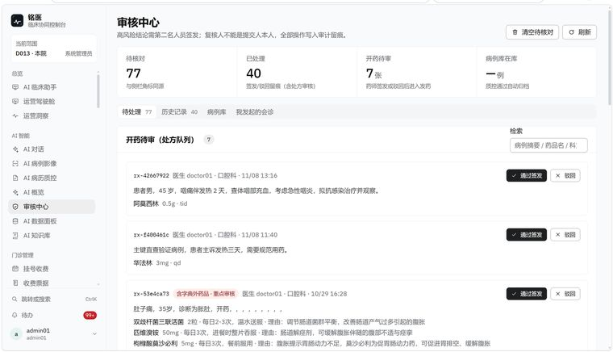</a><br/><sub><b>审核中心</b></sub></td>
<td width="33%" valign="top" align="center"><a href="docs/showcase/screenshots/37-consultation.png" title="发起会诊与状态流转（待受理 / 会诊中 / 已完成 / 已结束）">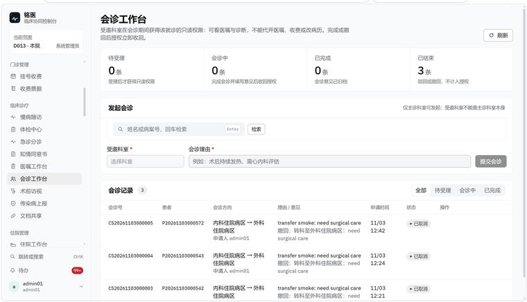</a><br/><sub><b>会诊工作台</b></sub></td>
<td width="33%" valign="top" align="center"><a href="docs/showcase/screenshots/38-clinical-pathway.png" title="按路径模板执行每日任务，在径/出径与模板版本管理">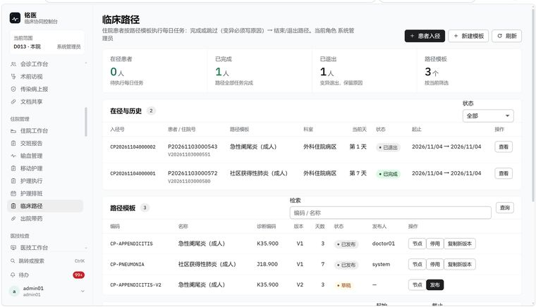</a><br/><sub><b>临床路径</b></sub></td>
</tr>
<tr>
<td width="33%" valign="top" align="center"><a href="docs/showcase/screenshots/39-handover.png" title="班次说明、在院患者交班清单、待办事项与交班签字">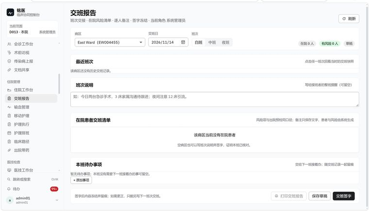</a><br/><sub><b>交班报告</b></sub></td>
<td width="33%" valign="top" align="center"><a href="docs/showcase/screenshots/40-handover-todo.png" title="AI 待核对 77 / 出院受阻 31 / 未交班病区 153">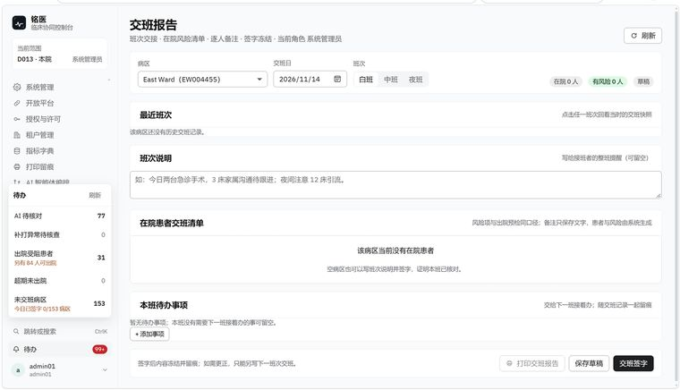</a><br/><sub><b>交班待办</b></sub></td>
<td width="33%" valign="top" align="center"><a href="docs/showcase/screenshots/41-pacs.png" title="PACS 阅片队列，序列与胶片调阅">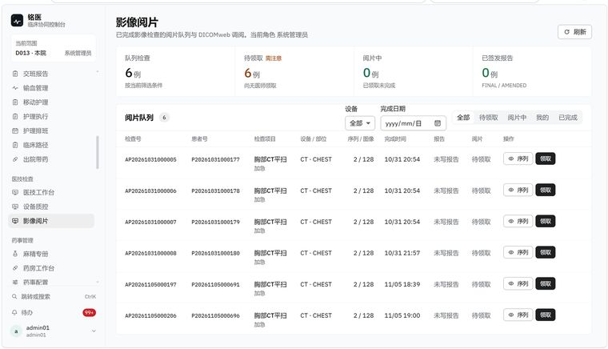</a><br/><sub><b>影像阅片</b></sub></td>
</tr>
<tr>
<td width="33%" valign="top" align="center"><a href="docs/showcase/screenshots/42-consent-print.png" title="CA 签署与打印预览，签署轨迹可追溯">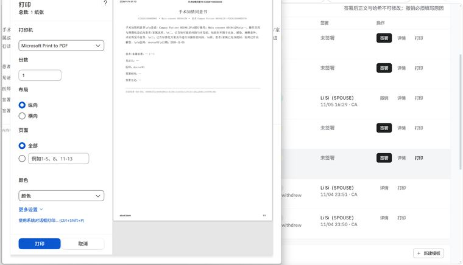</a><br/><sub><b>手术知情同意书</b></sub></td>
<td width="33%" valign="top" align="center"><a href="docs/showcase/screenshots/43-surgery-schedule.png" title="手术间台次甘特图、本间利用率与台次详情">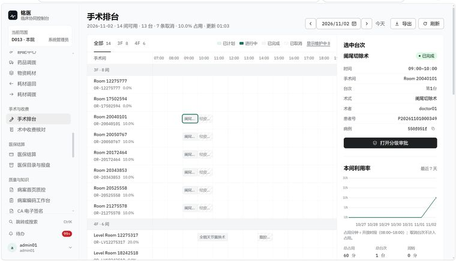</a><br/><sub><b>手术排台</b></sub></td>
<td width="33%" valign="top" align="center"><a href="docs/showcase/screenshots/44-consent-reprint.png" title="补打原因留痕（质量问题 / 患者要求 / 信息变更）">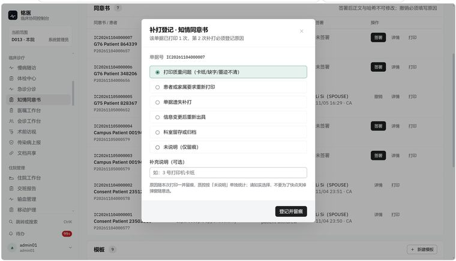</a><br/><sub><b>知情同意书补打</b></sub></td>
</tr>
<tr>
<td width="33%" valign="top" align="center"><a href="docs/showcase/screenshots/45-consent-template.png" title="模板管理与签署状态统计">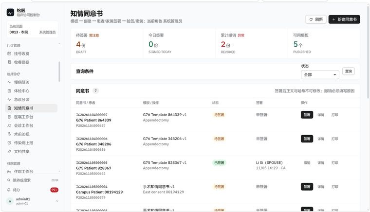</a><br/><sub><b>同意书模板</b></sub></td>
<td width="33%" valign="top" align="center"><a href="docs/showcase/screenshots/46-emergency.png" title="预检分诊 1-2 级绿色通道与留观床位三级联动">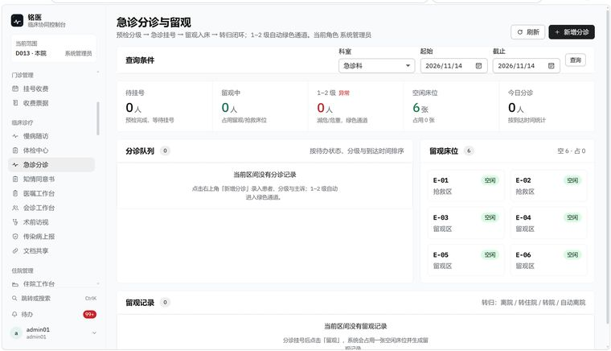</a><br/><sub><b>急诊分诊与留观</b></sub></td>
<td width="33%" valign="top" align="center"><a href="docs/showcase/screenshots/47-infection.png" title="感染病例上报目录、及时率与立即扫描">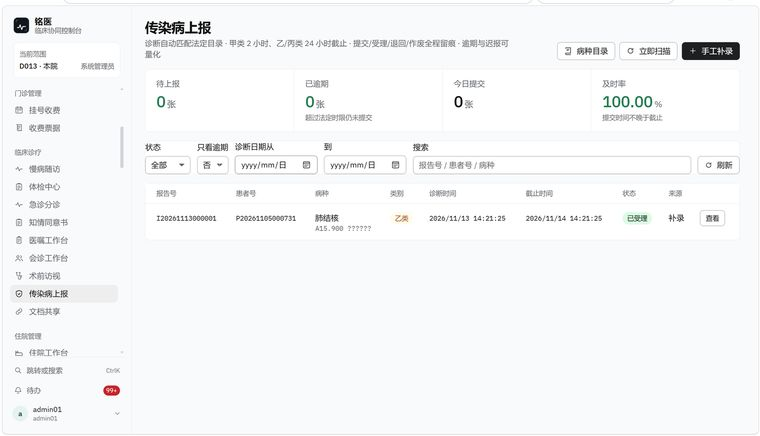</a><br/><sub><b>传染病院上报</b></sub></td>
</tr>
<tr>
<td width="33%" valign="top" align="center"><a href="docs/showcase/screenshots/48-nursing-roster.png" title="排班发布状态、护士工作量覆盖与夜班统计">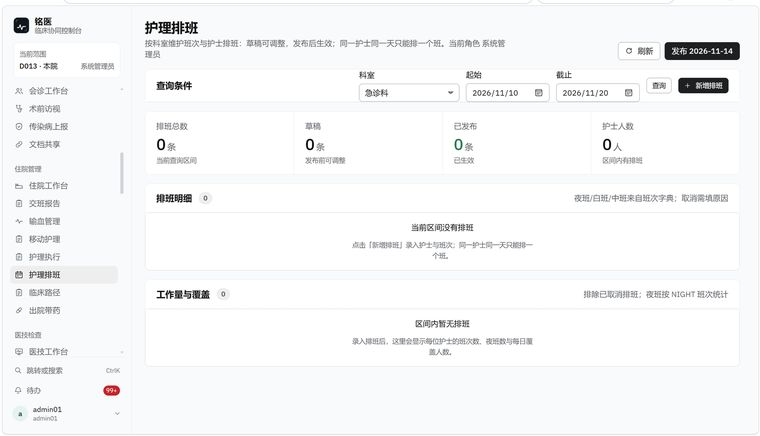</a><br/><sub><b>护理排班</b></sub></td>
<td width="33%" valign="top" align="center"><a href="docs/showcase/screenshots/49-health-exam.png" title="套餐快照、项目数、总价与发布状态">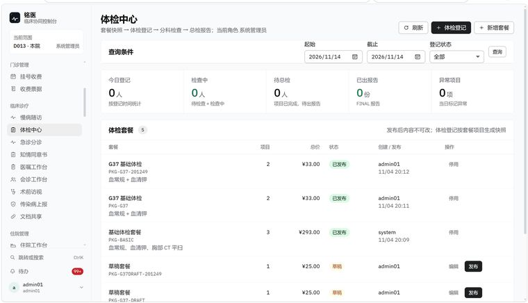</a><br/><sub><b>体检中心</b></sub></td>
<td width="33%" valign="top" align="center"><a href="docs/showcase/screenshots/50-device-qc.png" title="设备台账、质控记录与维修/报废状态">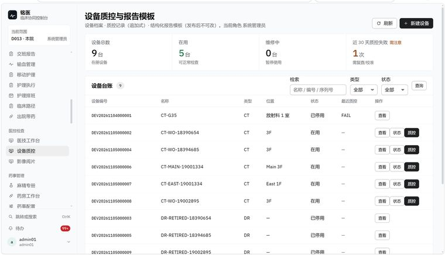</a><br/><sub><b>设备质控</b></sub></td>
</tr>
</table>


### 运营与平台治理（8）

<table>
<tr>
<td width="33%" valign="top" align="center"><a href="docs/showcase/screenshots/60-data-quality.png" title="16 条只读 SQL 质量规则 + 24h 执行/通过/异常统计">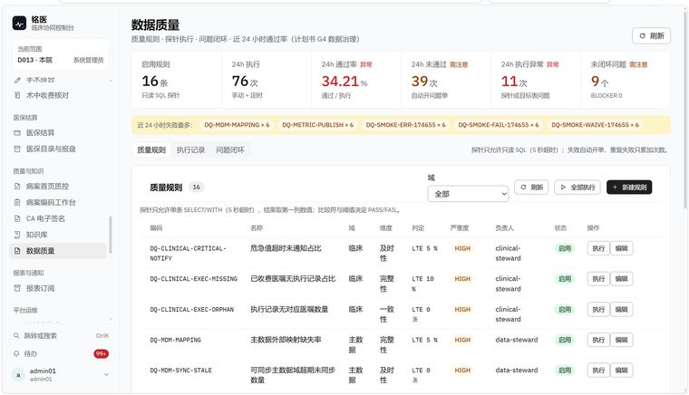</a><br/><sub><b>数据质量</b></sub></td>
<td width="33%" valign="top" align="center"><a href="docs/showcase/screenshots/61-release.png" title="组件版本发布、30 天部署成功率与回滚操作">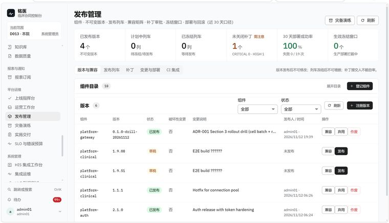</a><br/><sub><b>发布管理</b></sub></td>
<td width="33%" valign="top" align="center"><a href="docs/showcase/screenshots/62-system-admin.png" title="账号 / 角色 / 院区 / 审计的统一管理面">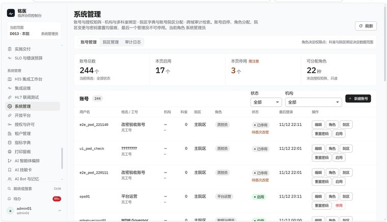</a><br/><sub><b>系统管理</b></sub></td>
</tr>
<tr>
<td width="33%" valign="top" align="center"><a href="docs/showcase/screenshots/63-tenant.png" title="多租户台账、实例码、Cell 入口与变更记录">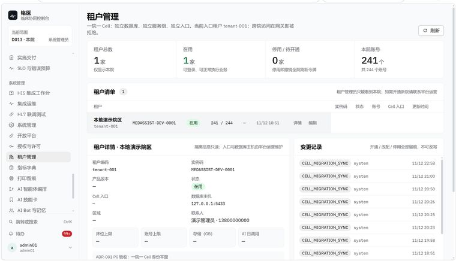</a><br/><sub><b>租户与 Cell</b></sub></td>
<td width="33%" valign="top" align="center"><a href="docs/showcase/screenshots/64-license.png" title="授权状态、模块授权、配额使用（床位/账号/AI 调用）">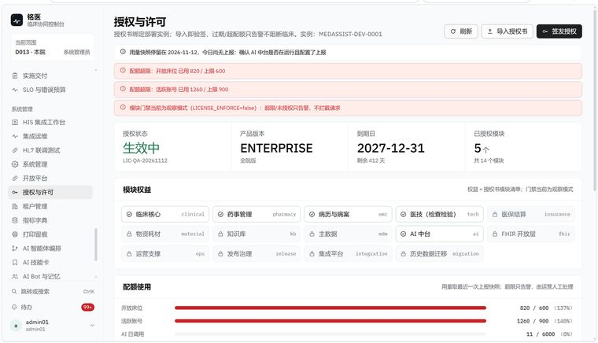</a><br/><sub><b>授权与许可</b></sub></td>
<td width="33%" valign="top" align="center"><a href="docs/showcase/screenshots/65-material.png" title="耗材目录、库存金额、近效期批次与批次领用">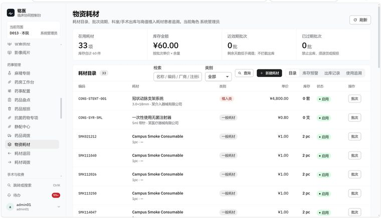</a><br/><sub><b>物资耗材</b></sub></td>
</tr>
<tr>
<td width="33%" valign="top" align="center"><a href="docs/showcase/screenshots/66-receipt.png" title="票据开具/重打/作废留痕与电子票据对账推送"></a><br/><sub><b>收费票据</b></sub></td>
<td width="33%" valign="top" align="center"><a href="docs/showcase/screenshots/67-xds.png" title="IHE XDS 文档注册与查询（出院小结/检验报告 CDA）"></a><br/><sub><b>文档共享</b></sub></td>
<td width="33%"></td>
</tr>
</table>


---

## 🧩 能力矩阵

| 域 | 关键能力 | 关键设计（可验证） |
|---|---|---|
| **身份** | 登录 / 刷新 / 撤销 / OAuth2 客户端凭证 / 多院区 | 令牌撤销名单 + 网关重写身份头，客户端伪造 `X-Actor` 无效 |
| **患者** | 建档 / 查重 / 合并 / 跨系统标识 | 证件号、手机号、住址 AES-GCM；盲化索引做等值查重 |
| **临床** | 挂号 / 就诊 / 医嘱 / 收费 / 住院 / 手术 / 输血 / 体检 / 慢病 / 急诊 | 幂等键防重放；乐观锁 `version`；非法状态跃迁返回 409 |
| **药事** | 药品目录 / 库存 / 审方 / 发药 / 麻精 / 抗菌药物 | 342 种药品、307 条相互作用规则（高危 131）在开方时拦截 |
| **医技** | 申请 / 标本 / 报告 / 危急值 / PACS | 危急值通知人+时间必填；DICOMweb 与 DIMSE 双通道 |
| **病案** | 病历 / 质控 / CA 签名 / 归档 / CDA / XDS | 签名策略守卫；归档后不可改；IHE XDS 文档注册 |
| **医保** | 目录 / 参保 / 结算 / 清单 / 对账 | 分组器不可用返回 **503**，而不是静默降级成 0 元 |
| **数据** | 主数据 / 外部映射 / 指标字典 / 质量规则 | 四眼审批 + 版本链；质量规则是只读 SQL 探针 |
| **集成** | FHIR R4 / HL7 v2 / 开放平台 | 17 个只读 scope；按路径 QPS 限流 + 慢调用熔断 |
| **运维** | 工单 / SLA / 值班 / 事件 / SLO / 上线指挥台 | `escalation_minutes` 自动消费；**SKIP ≠ PASS** 的门禁语义 |
| **许可** | 授权签发校验 / 发布审批 / 证据包 | 院方构建禁止自签；演示实例码在生产拒绝启动 |
| **AI** | 分诊 / 用药 / 文献 / 影像 / MDT / RAG / Agent 治理 | 证据边界与拒答；漂移监测；模型卡；境外端点 fail-closed |

---

## 🚀 十分钟跑起来

```bash
# 0) 依赖：JDK 21 · Maven 3.9+ · Node 20+ · Python 3.11 · Docker
git clone https://github.com/poincare-lijiashu/medical-agent.git
cd medical-agent

# 1) 密钥（缺一个就拒绝启动 —— 这是设计，不是故障）
cp .env.example .env.local
#   AUTH_JWT_SECRET      ≥ 32 位随机串（Java 与 Python 必须同值）
#   INTERNAL_API_TOKEN   ≥ 32 位随机串（16 个服务 + AI 中台同值）

# 2) 基础设施
docker compose up -d postgres redis milvus minio etcd orthanc

# 3) 构建与启动
mvn -f platform/pom.xml -DskipTests package
python -m uvicorn backend.main:app --host 127.0.0.1 --port 8001 &
powershell -File scripts/run_platform_demo.ps1      # Windows
# Linux/macOS：按脚本里的 16 个 java -jar 顺序启动即可

# 4) 打开 http://127.0.0.1:8001
```

<details>
<summary><b>启动失败怎么排查（按这个顺序，不要跳步）</b></summary>

1. **端口齐不齐**：`8080–8095` 十六个 + `8001`，缺一个就会"登录成功但部分页面 401"；
2. **两端密钥同值**：`AUTH_JWT_SECRET`（Java `JWT_SECRET` 与 Python 同一值）；
3. **内部令牌同值**：`INTERNAL_API_TOKEN`（16 个服务 + AI 中台同一值）；
4. **环境显式声明**：`MEDASSIST_ENV=dev`，否则缺省按生产处理 → 拒绝启动；
5. 以上都对，再看具体服务日志尾部（脚本会打印失败的 25 行）。

> 演示账号仅在 `AUTH_SEED_DEMO=true` 时注入；生产必须关闭。

</details>

---

## 📦 部署形态

| 形态 | 方式 | 适用 |
|---|---|---|
| 本地演示 | `docker compose` + `scripts/run_platform_demo.ps1` | 开发、验收演示 |
| 单院私有化 | Helm Chart（50 个模板 / 三套 values） | 院内 K8s |
| 多院隔离 | 租户入口路由 + 独立 Cell 命名空间 | 集团 / 医共体 |

生产启动守卫覆盖：开发密钥、默认口令、许可未绑定、境外模型端点、非回环监听。

**唯一前端，根路径托管**：控制台只有一个 Vue 3 工程，构建产物在
`frontend-console/dist/`（已入库，免装 Node 也能跑），由 AI 中台进程在 `/` 直接托管；
`vite.config.ts` 的 `base` 固定为 `/`，不存在 `/console` 子路径形态。改前端后
`cd frontend-console && npm run build` 重新生成该目录即可。

---

## ✅ 质量信号（都可复核）

| 项 | 数值 | 怎么验 |
|---|---|---|
| Python 测试 | **2,134 passed / 12 skipped**（覆盖率 85.95%，门槛 85%） | `pytest -m "not e2e"` |
| Java 测试 | **716 passed**（16 模块矩阵） | `mvn -f platform/pom.xml test` |
| CI | 10 个 job 全绿：pytest / lint / vuln-scan / postgres-it / migration-lint / platform / frontend / image-build / helm / e2e | [Actions](https://github.com/poincare-lijiashu/medical-agent/actions) |
| 前端 | `vue-tsc --noEmit` 通过 + `vite build` | `cd frontend-console && npm run typecheck` |
| 迁移安全 | 312 个脚本，lint 拦截破坏性变更 | `scripts/migration_safety_lint.ps1` |
| 提交门禁 | pre-push：分支保护 / 冲突标记 / 密钥 / ruff | `sh .githooks/pre-push` |
| 交付清单 | helm lint + dev/staging/prod 三环境渲染 | `helm template ... -f values-<env>.yaml` |

---

## 🧭 我们没说谎的地方

这是本仓库最不像"宣传页"的一节，但也是最能说明工程态度的部分。

| 已知边界 | 现状 | 影响 |
|---|---|---|
| **医嘱执行态** | 状态机是 `PLACED → CHARGED → CANCELLED`，执行记录落在护理执行表，未回写统一 `EXECUTED` | 无法用单一状态查询"这条医嘱执行了没" |
| **姓名类字段** | 证件号/手机号/住址已加密，**姓名与生日仍是明文列** | 不满足最严格的存储保密性要求 |
| **旧版 E2E** | 16 个浏览器用例已显式 skip 并写明原因 | 只剩 3 项真实冒烟，且它们需要**完整平台栈**（控制台登录经 Java 网关）；CI 只起 Python 进程时按"平台栈不可达"显式 skip，不会假红也不会假绿 |
| **覆盖率** | JaCoCo 已绑定，但覆盖率门槛仍为宽松的 50% | 新代码缺少强制覆盖率约束 |
| **第三方评测** | 综合 65.9 / 100 | 数据治理与测试工程是短板 |

引用第三方评测的原话：

> **这是一个"架构与安全设计水平明显高于同规模医院平台基线、但运行态数据与门禁尚未真正跑起来"的系统。**
> 软件骨架可交付，但"可验收"尚未成立。

我们接受这个判断，并把它当成待办清单 —— 已整改 12 项 Critical/高危（见
[09-REMEDIATION.md](docs/eval/2026-11-13/09-REMEDIATION.md)），其余仍挂在清单上。

---

## 📚 文档地图

| 想了解 | 去哪 |
|---|---|
| 系统架构与 7 张图 | [docs/architecture/ARCHITECTURE.md](docs/architecture/ARCHITECTURE.md) |
| 界面全览（50 张 + 搜索 + 灯箱） | [docs/showcase/index.html](docs/showcase/index.html) |
| 评测报告与整改证据 | [docs/eval/2026-11-13/SUMMARY.md](docs/eval/2026-11-13/SUMMARY.md) |
| 开放平台 API（17 个只读 scope） | [docs/openplatform/API.md](docs/openplatform/API.md) |
| 设计系统与前端约定 | [docs/DESIGN-SYSTEM.md](docs/DESIGN-SYSTEM.md) |
| CI 门禁与分支保护 | [docs/ci/BRANCH-PROTECTION.md](docs/ci/BRANCH-PROTECTION.md) |
| 部署与私有化交付 | [deploy/README.md](deploy/README.md) |
| 上传 GitHub 的隐私/密钥排查 | [docs/ci/GITHUB-UPLOAD-PLAN.md](docs/ci/GITHUB-UPLOAD-PLAN.md) |

---

## 技术栈

| 层 | 选型 |
|---|---|
| 后端 | Java 21 · Spring Boot 4 · Spring Cloud · Nacos · Flyway · PostgreSQL 15 |
| 前端 | Vue 3.5 · TypeScript 5.7 · Vite 6 · 自建设计系统（无 UI 框架） |
| AI | Python 3.11 · FastAPI · LangChain / LangGraph · Milvus（BGE-M3）· 国产 MaaS |
| 集成 | HL7 FHIR R4 · HL7 v2 · IHE XDS · OAuth2 client_credentials |
| 交付 | Docker · Helm · Prometheus / Alertmanager / SkyWalking · Orthanc（DICOM） |

---

## 许可与合规

本仓库为**专有软件**，公开用于技术评审与交付评估，**不授予**复制、修改、再分发或商业使用许可。
详见 [LICENSE](LICENSE) 与第三方组件清单 [NOTICE](NOTICE)。

> [!WARNING]
> 本项目是工程演示与交付基线，**未经临床验证，不构成医疗器械**。
> 任何临床决策必须由具备资质的医师作出；请勿将演示数据用于真实诊疗。

<p align="center">
  <sub>MedAssist 铭医 · 用工程约束守住临床安全 · v2.0 · 2026</sub>
</p>
