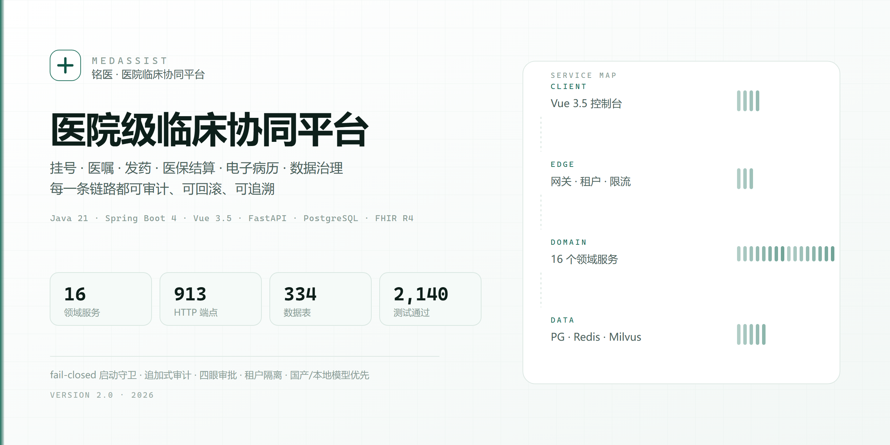
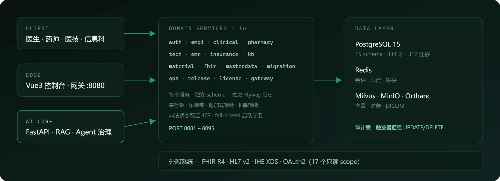
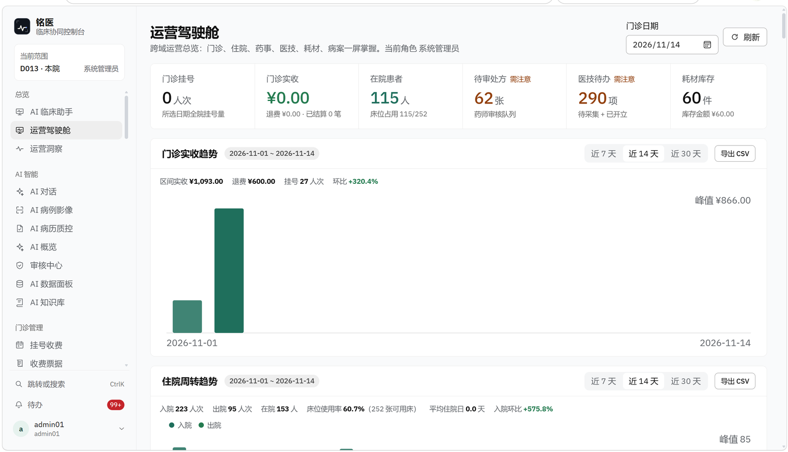
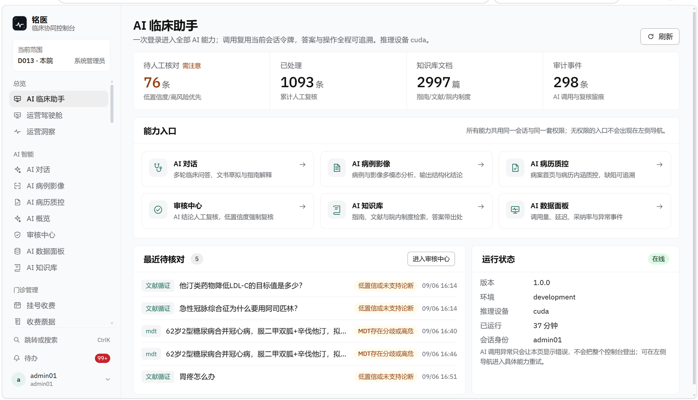
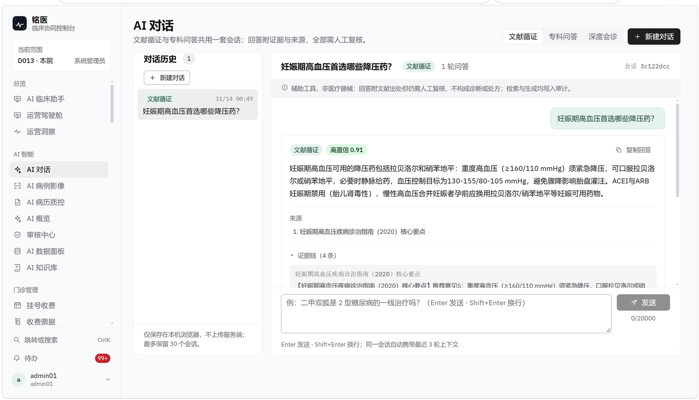
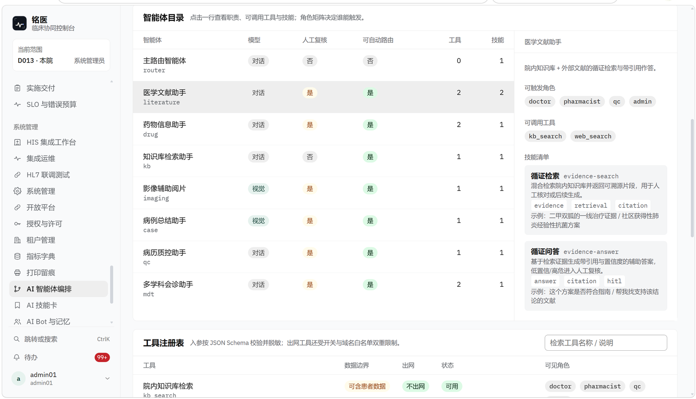
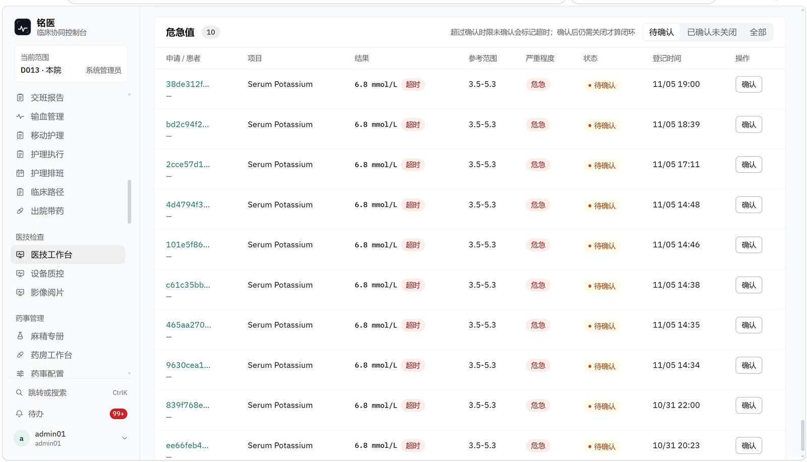
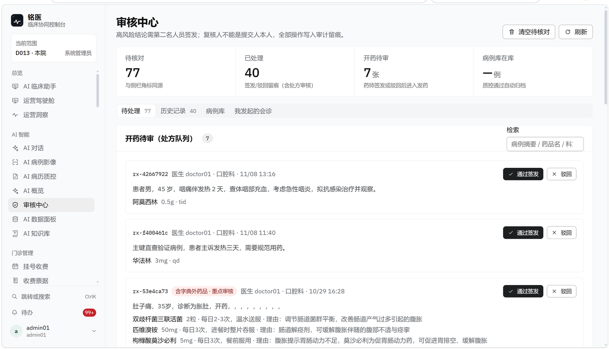
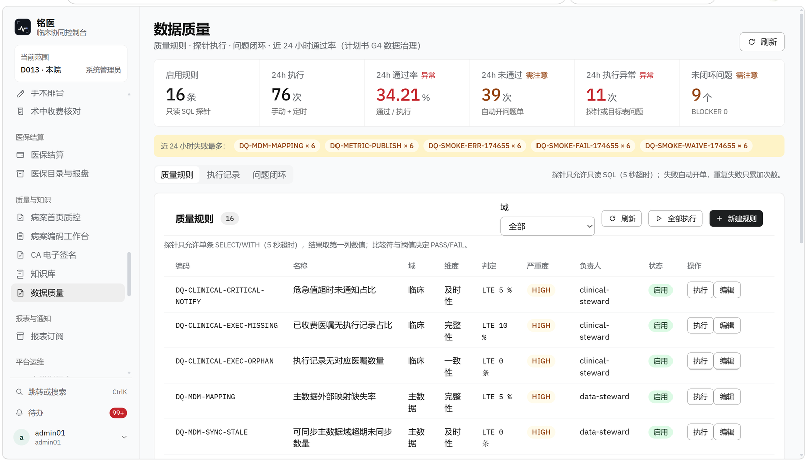
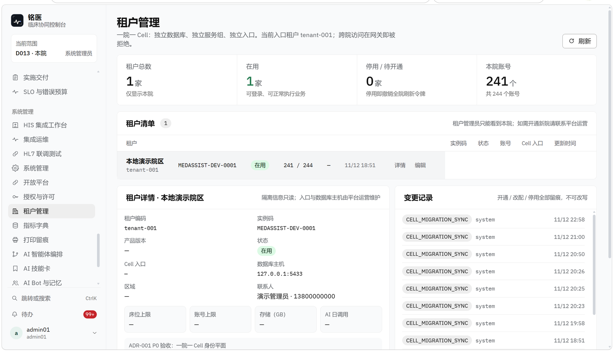

<!-- ═══════════════════════════════════════════════════════════════════════════
     MedAssist 铭医 · GitHub 主页（v2.0）
     设计：深色工程仪表盘风 —— hero 深浅双版由 <picture> 自动切换；
          首屏即给"规模 + 可信度 + 视觉证据"，不做形容词堆砌。
     ═══════════════════════════════════════════════════════════════════════════ -->

<p align="center">
  <picture>
    <source media="(prefers-color-scheme: dark)"  srcset="docs/showcase/assets/hero-dark.png">
    <source media="(prefers-color-scheme: light)" srcset="docs/showcase/assets/hero-light.png">
    
  </picture>
</p>

<h3 align="center">医院里跑得起来的那一层，才是真系统</h3>

<p align="center">
  <sub>
    16 个独立领域服务 · 913 个 HTTP 端点 · 15 个数据库 schema · 334 张表 · 312 个迁移<br/>
    从挂号到医保结算，从医嘱执行到危急值闭环，从主数据治理到 AI 循证问答
  </sub>
</p>

<p align="center">
  
  
  
  
  
  <br/>
  
  
  
  
  
</p>

<p align="center">
  <a href="#-三十秒看懂"><b>三十秒看懂</b></a> ·
  <a href="#-架构">架构</a> ·
  <a href="#-界面">界面（50 张）</a> ·
  <a href="#-能力矩阵">能力矩阵</a> ·
  <a href="#-十分钟跑起来">快速开始</a> ·
  <a href="#-我们没说谎的地方">已知边界</a> ·
  <a href="docs/showcase/index.html">完整展示页</a>
</p>

---

## ⏱ 三十秒看懂

大多数医疗系统停在"能建"，这个项目想解决的是"能跑、能查、能兜底"。

<table>
<tr>
<td width="33%" valign="top">

**它会拒绝启动**

开发默认密钥、默认口令、未绑定实例码的许可、
指向境外的模型端点 —— 任一条命中生产环境，
服务**直接拒绝启动**，而不是打条日志继续跑。

</td>
<td width="33%" valign="top">

**它会留下证据**

14 张审计表由数据库触发器强制只追加，
应用层改不动。谁在何时、从哪个 IP、
对哪条业务记录做了什么，可追溯到 traceId。

</td>
<td width="33%" valign="top">

**它会承认没做到**

医嘱还没有统一的 `EXECUTED` 回写，
姓名类字段仍是明文，16 个旧 E2E 用例仍挂着 skip。
这些写在[已知边界](#-我们没说谎的地方)，也写在评测报告里。

</td>
</tr>
</table>

> 第三方评测给出的综合分是 **65.9 / 100**。我们没有把这个数字藏起来，
> 也没有把未整改项从清单里删掉 —— 完整报告与 30 项缺陷见
> [docs/eval/2026-11-13/SUMMARY.md](docs/eval/2026-11-13/SUMMARY.md)。

---

## 📐 架构

<p align="center">
  
</p>

**四个刻意的取舍**

| 取舍 | 原因 | 代价（我们认） |
|---|---|---|
| **按域拆 16 个服务，不做一个单体** | 每个域独立 schema + 独立 Flyway 历史，迁移互不阻塞；药房发药慢不会拖垮挂号 | 跨域查询要走 API 组合，不能一条 SQL 联表 |
| **控制台与 AI 中台同源（单端口）** | `/api/v2` 由中台反代到网关，浏览器只面对一个源；免 CORS、免两套登录 | 中台成为首跳，需要独立的连接池与超时策略 |
| **审计下沉到数据库触发器** | 应用层"自觉写审计"迟早会漏；触发器拒绝 `UPDATE/DELETE` | 审计表只增不减，需要定期归档策略 |
| **AI 只允许本地/国产模型** | 病历正文出境是合规红线；生产环境境外端点拒绝启动 | 可选模型范围变窄，需要院内 GPU 或国产 MaaS |

完整图集（7 张：上下文 / 服务地图 / 医嘱链路 / AI 链路 / 数据 / 部署 / 安全纵深）见
**[docs/architecture/ARCHITECTURE.md](docs/architecture/ARCHITECTURE.md)**。

---

## 🖥 界面

> 50 张真实截图，来自本机演示环境（合成数据，无真实患者）。
> 点击任一图片可看全尺寸；完整画廊带搜索与放大：
> **[docs/showcase/index.html](docs/showcase/index.html)**

### 运营与入口

<table>
<tr>
<td width="50%"></td>
<td width="50%"></td>
</tr>
<tr>
<td><sub><b>运营驾驶舱</b> — 门诊挂号、实收、在院患者、待审处方、医技待办、耗材库存六大 KPI</sub></td>
<td><sub><b>AI 临床助手</b> — 待复核 76 / 已处理 1093 / 知识库 2997 / 审计 298</sub></td>
</tr>
</table>

### AI 中台：证据优先，允许拒答

<table>
<tr>
<td width="50%"></td>
<td width="50%"></td>
</tr>
<tr>
<td><sub><b>循证问答</b> — 置信度 0.91 + 来源 + 证据链；无证据时输出"资料不足"而不是编造</sub></td>
<td><sub><b>智能体编排</b> — 智能体目录、工具注册表与技能清单，能力域自动路由</sub></td>
</tr>
</table>

### 临床闭环：危急值不会烂在系统里

<table>
<tr>
<td width="50%"></td>
<td width="50%"></td>
</tr>
<tr>
<td><sub><b>危急值闭环</b> — 血钾 6.8 mmol/L 超时未确认逐条标红，闭环才消账</sub></td>
<td><sub><b>审核中心</b> — AI 高风险结论必须二人复核：待核对 77 / 开药待审 7</sub></td>
</tr>
</table>

### 平台治理

<table>
<tr>
<td width="50%"></td>
<td width="50%"></td>
</tr>
<tr>
<td><sub><b>数据质量</b> — 16 条只读 SQL 探针，24h 执行/通过/异常统计，失败自动开单</sub></td>
<td><sub><b>租户与 Cell</b> — 多租户台账、实例码、Cell 入口与变更记录</sub></td>
</tr>
</table>

<details>
<summary><b>展开其余 42 张截图索引</b></summary>

| 域 | 页面 |
|---|---|
| 入口与总览 | 登录 · 运营驾驶舱 · 运营指标明细 · 运营洞察下钻 |
| AI 中台与治理 | AI 运营看板 · AI 审计与日志 · AI 对话（能力域路由 / 文献循证 / 多轮问诊）· 影像分析 · 病历质控 · 智能体目录 · 能力开关与路由 · 模型合规检查 · 实验台 · Bot 与记忆 · 技能卡 · 模型配置与密钥盘点 · 公告面板 · 知识库 |
| 临床业务闭环 | 挂号收费 · 住院工作台 · 医护工作台 · 危急值闭环 · 药房工作台 · 药事配置 · 审核中心 · 会诊工作台 · 临床路径 · 交班报告 · 交班待办 · 影像阅片 · 手术知情同意书 · 手术排台 · 同意书补打 · 同意书模板 · 急诊分诊留观 · 传染病上报 · 护理排班 · 体检中心 · 设备质控 |
| 运营与平台治理 | 数据质量 · 发布管理 · 系统管理 · 租户与 Cell · 授权与许可 · 物资耗材 · 收费票据 · 文档共享（XDS） |

</details>

---

## 🧩 能力矩阵

| 域 | 关键能力 | 关键设计（可验证） |
|---|---|---|
| **身份** | 登录 / 刷新 / 撤销 / OAuth2 客户端凭证 / 多院区 | 令牌撤销名单 + 网关重写身份头，客户端伪造 `X-Actor` 无效 |
| **患者** | 建档 / 查重 / 合并 / 跨系统标识 | 证件号、手机号、住址 AES-GCM；盲化索引做等值查重 |
| **临床** | 挂号 / 就诊 / 医嘱 / 收费 / 住院 / 手术 / 输血 / 体检 / 慢病 / 急诊 | 幂等键防重放；乐观锁 `version`；非法状态跃迁返回 409 |
| **药事** | 药品目录 / 库存 / 审方 / 发药 / 麻精 / 抗菌药物 | 342 种药品、307 条相互作用规则（高危 131）在开方时拦截 |
| **医技** | 申请 / 标本 / 报告 / 危急值 / PACS | 危急值通知人+时间必填；DICOMweb 与 DIMSE 双通道 |
| **病案** | 病历 / 质控 / CA 签名 / 归档 / CDA / XDS | 签名策略守卫；归档后不可改；IHE XDS 文档注册 |
| **医保** | 目录 / 参保 / 结算 / 清单 / 对账 | 分组器不可用返回 **503**，而不是静默降级成 0 元 |
| **数据** | 主数据 / 外部映射 / 指标字典 / 质量规则 | 四眼审批 + 版本链；质量规则是只读 SQL 探针 |
| **集成** | FHIR R4 / HL7 v2 / 开放平台 | 17 个只读 scope；按路径 QPS 限流 + 慢调用熔断 |
| **运维** | 工单 / SLA / 值班 / 事件 / SLO / 上线指挥台 | `escalation_minutes` 自动消费；**SKIP ≠ PASS** 的门禁语义 |
| **许可** | 授权签发校验 / 发布审批 / 证据包 | 院方构建禁止自签；演示实例码在生产拒绝启动 |
| **AI** | 分诊 / 用药 / 文献 / 影像 / MDT / RAG / Agent 治理 | 证据边界与拒答；漂移监测；模型卡；境外端点 fail-closed |

---

## 🚀 十分钟跑起来

```bash
# 0) 依赖：JDK 21 · Maven 3.9+ · Node 20+ · Python 3.11 · Docker
git clone https://github.com/poincare-lijiashu/medical-agent.git
cd medical-agent

# 1) 密钥（缺一个就拒绝启动 —— 这是设计，不是故障）
cp .env.example .env.local
#   AUTH_JWT_SECRET      ≥ 32 位随机串（Java 与 Python 必须同值）
#   INTERNAL_API_TOKEN   ≥ 32 位随机串（16 个服务 + AI 中台同值）

# 2) 基础设施
docker compose up -d postgres redis milvus minio etcd orthanc

# 3) 构建与启动
mvn -f platform/pom.xml -DskipTests package
python -m uvicorn backend.main:app --host 127.0.0.1 --port 8001 &
powershell -File scripts/run_platform_demo.ps1      # Windows
# Linux/macOS：按脚本里的 16 个 java -jar 顺序启动即可

# 4) 打开 http://127.0.0.1:8001
```

<details>
<summary><b>启动失败怎么排查（按这个顺序，不要跳步）</b></summary>

1. **端口齐不齐**：`8080–8095` 十六个 + `8001`，缺一个就会"登录成功但部分页面 401"；
2. **两端密钥同值**：`AUTH_JWT_SECRET`（Java `JWT_SECRET` 与 Python 同一值）；
3. **内部令牌同值**：`INTERNAL_API_TOKEN`（16 个服务 + AI 中台同一值）；
4. **环境显式声明**：`MEDASSIST_ENV=dev`，否则缺省按生产处理 → 拒绝启动；
5. 以上都对，再看具体服务日志尾部（脚本会打印失败的 25 行）。

> 演示账号仅在 `AUTH_SEED_DEMO=true` 时注入；生产必须关闭。

</details>

---

## 📦 部署形态

| 形态 | 方式 | 适用 |
|---|---|---|
| 本地演示 | `docker compose` + `scripts/run_platform_demo.ps1` | 开发、验收演示 |
| 单院私有化 | Helm Chart（50 个模板 / 三套 values） | 院内 K8s |
| 多院隔离 | 租户入口路由 + 独立 Cell 命名空间 | 集团 / 医共体 |

生产启动守卫覆盖：开发密钥、默认口令、许可未绑定、境外模型端点、非回环监听。

**唯一前端，根路径托管**：控制台只有一个 Vue 3 工程，构建产物在
`frontend-console/dist/`（已入库，免装 Node 也能跑），由 AI 中台进程在 `/` 直接托管；
`vite.config.ts` 的 `base` 固定为 `/`，不存在 `/console` 子路径形态。改前端后
`cd frontend-console && npm run build` 重新生成该目录即可。

---

## ✅ 质量信号（都可复核）

| 项 | 数值 | 怎么验 |
|---|---|---|
| Python 测试 | **2,140 passed / 1 skipped** | `pytest -m "not e2e"` |
| Java 测试 | 272 个测试文件 / 46,036 行 | `mvn -f platform/pom.xml test` |
| 前端 | `vue-tsc --noEmit` 通过 + `vite build` | `cd frontend-console && npm run typecheck` |
| 迁移安全 | 312 个脚本，lint 拦截破坏性变更 | `scripts/migration_safety_lint.ps1` |
| 提交门禁 | pre-push：分支保护 / 冲突标记 / 密钥 / ruff | `sh .githooks/pre-push` |
| CI | 11 个 job（pytest/lint/vuln-scan/postgres-it/migration-lint/platform/frontend/image-build/helm/eval-baseline/e2e） | `.github/workflows/ci.yml` |

---

## 🧭 我们没说谎的地方

这是本仓库最不像"宣传页"的一节，但也是最能说明工程态度的部分。

| 已知边界 | 现状 | 影响 |
|---|---|---|
| **医嘱执行态** | 状态机是 `PLACED → CHARGED → CANCELLED`，执行记录落在护理执行表，未回写统一 `EXECUTED` | 无法用单一状态查询"这条医嘱执行了没" |
| **姓名类字段** | 证件号/手机号/住址已加密，**姓名与生日仍是明文列** | 不满足最严格的存储保密性要求 |
| **旧版 E2E** | 16 个浏览器用例已显式 skip 并写明原因 | 只剩 3 项真实冒烟，且它们需要**完整平台栈**（控制台登录经 Java 网关）；CI 只起 Python 进程时按"平台栈不可达"显式 skip，不会假红也不会假绿 |
| **覆盖率** | JaCoCo 已绑定，但覆盖率门槛仍为宽松的 50% | 新代码缺少强制覆盖率约束 |
| **第三方评测** | 综合 65.9 / 100 | 数据治理与测试工程是短板 |

引用第三方评测的原话：

> **这是一个"架构与安全设计水平明显高于同规模医院平台基线、但运行态数据与门禁尚未真正跑起来"的系统。**
> 软件骨架可交付，但"可验收"尚未成立。

我们接受这个判断，并把它当成待办清单 —— 已整改 12 项 Critical/高危（见
[09-REMEDIATION.md](docs/eval/2026-11-13/09-REMEDIATION.md)），其余仍挂在清单上。

---

## 📚 文档地图

| 想知道什么 | 看哪里 |
|---|---|
| 系统架构（7 张图） | [docs/architecture/ARCHITECTURE.md](docs/architecture/ARCHITECTURE.md) |
| 部署与交付 | [docs/DEPLOY.md](docs/DEPLOY.md) · [deploy/README.md](deploy/README.md) |
| 运维、值班、SLO | [docs/OPERATIONS.md](docs/OPERATIONS.md) · [docs/SLO-20261111.md](docs/SLO-20261111.md) |
| 平台接口总览（913 端点） | [platform/README.md](platform/README.md) |
| 开放平台接入 | [docs/openplatform/API.md](docs/openplatform/API.md) |
| AI 模型卡与合规分级 | [docs/ai/MODEL-CARD.md](docs/ai/MODEL-CARD.md) |
| 第三方评测报告 | [docs/eval/2026-11-13/SUMMARY.md](docs/eval/2026-11-13/SUMMARY.md) |
| 设计系统 | [docs/DESIGN-SYSTEM.md](docs/DESIGN-SYSTEM.md) |
| 界面画廊（50 张） | [docs/showcase/index.html](docs/showcase/index.html) |

---

## 技术栈

<table>
<tr><td><b>后端</b></td><td>Java 21 · Spring Boot 4 · Spring Cloud Gateway · JetBrains/Jackson · Sentinel（限流熔断）· JdbcTemplate（显式 SQL）</td></tr>
<tr><td><b>前端</b></td><td>Vue 3.5 · TypeScript 5.7 · Vite 6 · 自建设计系统（无 UI 框架依赖）· IBM Plex</td></tr>
<tr><td><b>AI 中台</b></td><td>FastAPI · LangChain · Milvus（向量）· PHI 脱敏 · Agent 治理与漂移监测</td></tr>
<tr><td><b>数据</b></td><td>PostgreSQL 15（15 schema / 334 表 / 312 迁移）· Redis · MinIO · Orthanc（DICOM）</td></tr>
<tr><td><b>互操作</b></td><td>HL7 FHIR R4 · HL7 v2 · IHE XDS · OAuth2（client_credentials）</td></tr>
<tr><td><b>交付</b></td><td>Docker Compose · Helm（50 模板 / 3 环境）· Prometheus + Grafana + Alertmanager + Loki + SkyWalking</td></tr>
</table>

---

## 许可与合规

- 本仓库代码为**专有软件**，未经书面授权不得复制、分发或用于生产环境。
- 仓库内不含任何真实患者数据；截图与测试数据均为合成（`P2026…`、`Gxx Patient xxxxx`）。
- 含病例原文的本地数据文件（`data/consults.json` 等）已在 `.gitignore` 中排除，
  且已从 Git 历史中彻底移除。
- 第三方依赖许可清单见 `NOTICE`。

<p align="center">
  <sub>MedAssist 铭医 · 用工程约束守住临床安全 · v2.0 · 2026</sub>
</p>
