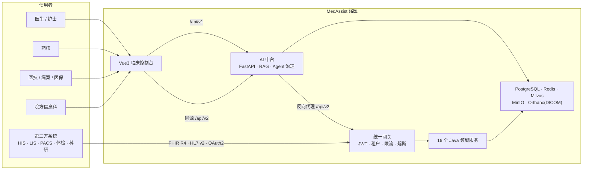
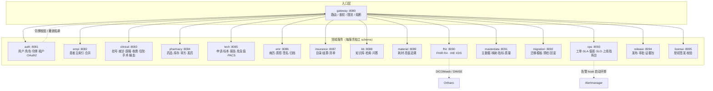
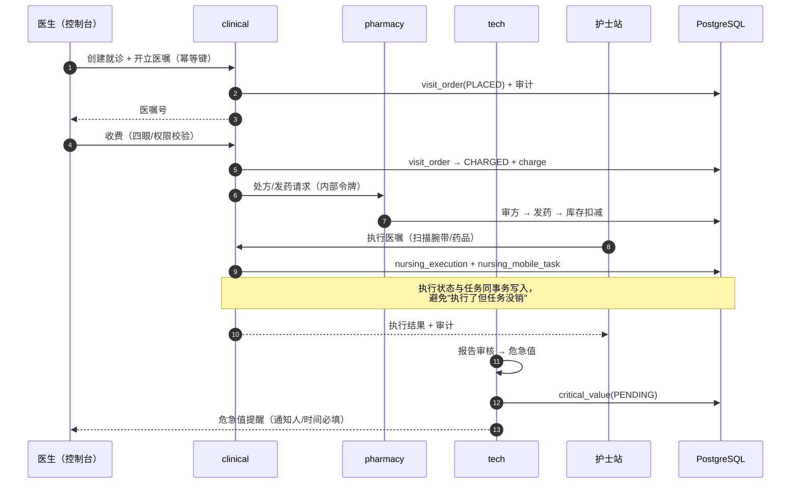
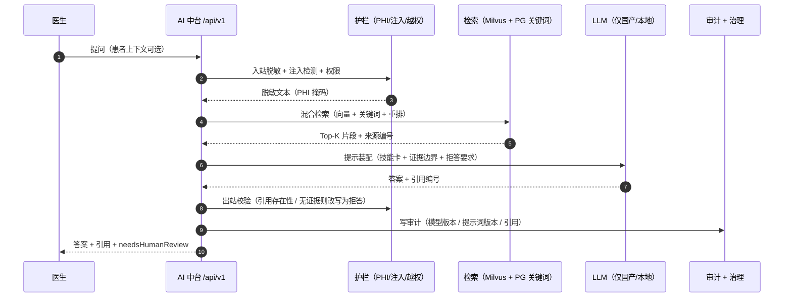
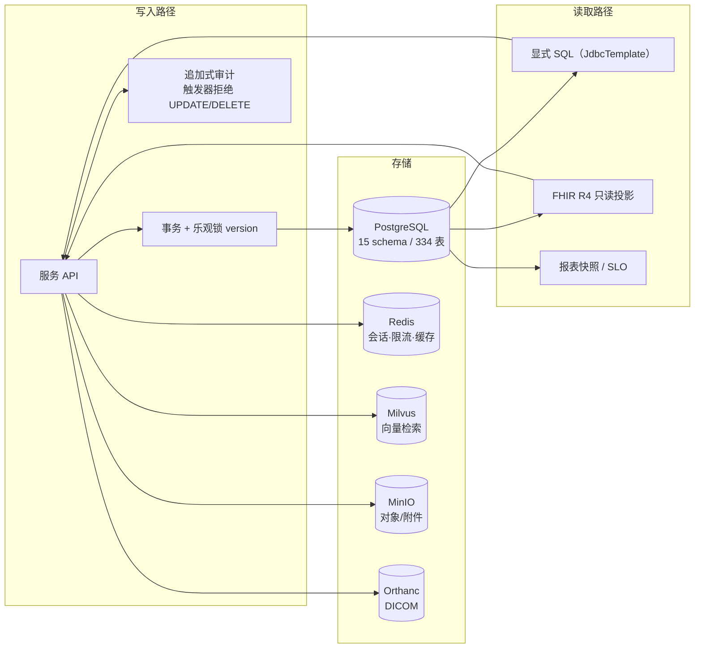
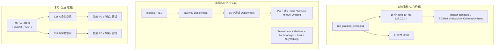
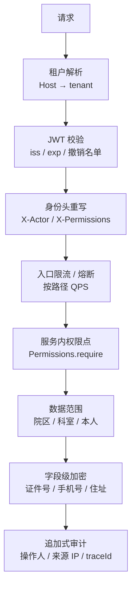
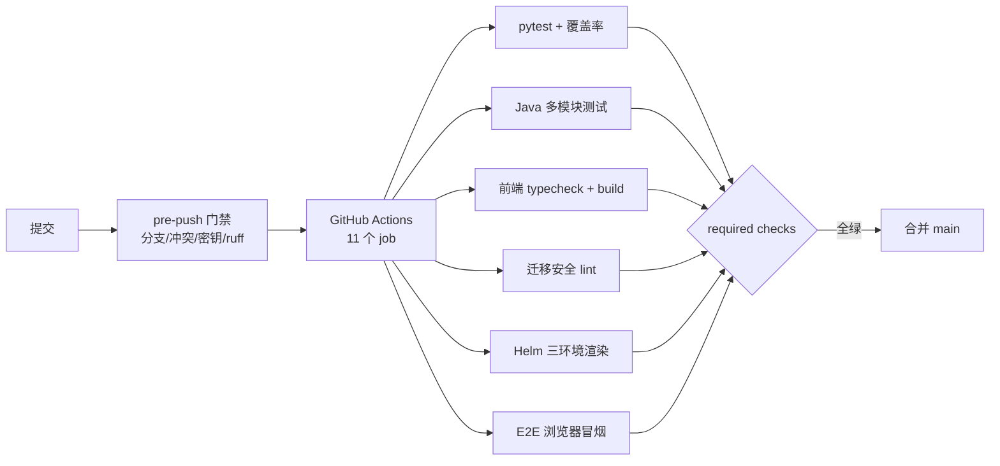

# MedAssist 铭医 · 系统架构

> 本文是**上传 GitHub 用的架构说明**，所有图都能被 GitHub 原生渲染（Mermaid）。
> 数字取自 2026-11-14 仓库实测：17 个 Maven 模块（16 个可部署服务）、913 个 Java 端点、
> 15 个业务 schema / 334 张表、312 个 Flyway 迁移、2,140 项 Python 测试通过。

---

## 1. 系统上下文

**设计取舍**：控制台与 AI 中台同源（8001），`/api/v2` 由中台反代到网关——
浏览器只面对一个源，避免 CORS、Cookie 跨域与"两个入口两套登录"。

---

## 2. 服务地图（端口即边界）

**为什么按域拆 16 个服务而不是一个大单体**：每个域有独立的 Flyway 历史
（`clinical_svc` / `emr_svc` / … 共 15 个 schema），迁移互不阻塞；
故障域也被隔离（药房发药慢不会拖垮挂号）。

---

## 3. 临床主链路（医嘱 → 收费 → 执行 → 回写）

> 已知边界（诚实标注）：医嘱状态机目前是 `PLACED → CHARGED → CANCELLED`，
> 执行态落在护理执行表，尚未回写为 `EXECUTED`；这是下一阶段的改造项，
> 不在架构图里"假装已实现"。

---

## 4. AI 问答链路（证据优先 + 拒答）

**三个硬约束**：
1. 模型提供方按域名分级（`local / domestic / foreign / unknown`），生产环境境外端点**拒绝启动**；
2. 治理库 ACTIVE 模型必须与运行时一致，不一致生产环境**拒绝启动**；
3. 无证据不给结论：引用缺失时输出"资料不足"而不是编造。

---

## 5. 数据架构

**治理约定**
- 迁移只前进：`V{n}__desc.sql`，CI 有 `migration_safety_lint` 拦截"非空列无默认值"等破坏性变更；
- 审计表只追加，数据库触发器兜底（不依赖应用自觉）；
- 主数据有版本链（`md_item_version`）与四眼审批，外部标准映射走待确认队列。

---

## 6. 部署拓扑

- 私有化交付：`deploy/helm/medassist-platform`（50 个模板，三套 values）；
- 本地交付：`docker-compose.yml` + `scripts/run_platform_demo.ps1`（一条命令拉起全部服务）；
- 生产启动守卫：开发密钥/默认口令/境外模型/许可未绑定 → **拒绝启动**（fail-closed）。

---

## 7. 安全纵深

> 已知边界：患者姓名/生日/过敏史目前是明文列（证件号/手机号/住址已 AES-GCM），
> 字段级加密补齐已列入整改清单，未在本文中宣称完成。

---

## 8. 质量与交付

| 指标 | 数值 |
|---|---:|
| Java 模块 / 可部署服务 | 17 / 16 |
| Java 端点 | 913 |
| Java 测试文件 / 测试行 | 272 / 46,036 |
| Python 测试（非 e2e，最近一次全量） | 2,140 通过 + 1 跳过 |
| 数据库 schema / 表 | 15 / 334 |
| Flyway 迁移脚本 | 312 |
| Helm 模板 | 50 |
| 前端 | Vue 3.5 + TS 5.7 + Vite 6.3，自建设计系统（无 UI 框架依赖） |

---

## 9. 文档地图

| 想知道什么 | 看哪里 |
|---|---|
| 部署与交付 | `docs/DEPLOY.md`、`deploy/README.md`、`docs/PROVISIONING-RUNBOOK.md` |
| 运维与值班 | `docs/OPERATIONS.md`、`docs/SLO-20261111.md` |
| 接口与集成 | `platform/README.md`、`docs/INTEGRATION.md`、`docs/openplatform/API.md` |
| AI 治理 | `docs/ai/MODEL-CARD.md`、`docs/eval/2026-11-13/06-ai-governance.md` |
| 第三方评测 | `docs/eval/2026-11-13/SUMMARY.md`（总分 65.9/100，含未整改清单） |
| 上传 GitHub | `docs/ci/GITHUB-UPLOAD-PLAN.md`、`docs/ci/BRANCH-PROTECTION.md` |
