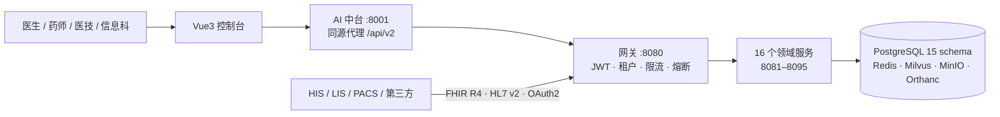

<p align="center">
  
</p>

<h1 align="center">铭医 MedAssist</h1>

<p align="center">
  <b>面向医院真实业务的临床协同平台</b><br/>
  医嘱闭环 · 医保结算 · 电子病历 · 检验检查 · 主数据治理 · AI 循证问答 · 私有化交付
</p>

<p align="center">
  
  
  
  
  
  
  
</p>

<p align="center">
  <a href="docs/architecture/ARCHITECTURE.md">架构</a> ·
  <a href="docs/openplatform/API.md">开放平台</a> ·
  <a href="docs/DEPLOY.md">部署</a> ·
  <a href="docs/eval/2026-11-13/SUMMARY.md">第三方评测</a> ·
  <a href="docs/ci/GITHUB-UPLOAD-PLAN.md">上传说明</a>
</p>

---

## 这是什么

一个**按医院真实业务建模**的临床协同平台：16 个独立领域服务、15 个数据库 schema、
913 个 HTTP 端点，覆盖从挂号、医嘱、收费、发药、检验检查、病历质控、医保结算
到主数据治理、运维值班、许可授权的完整链路；AI 中台提供带证据与拒答语义的临床问答。

它不是 CRUD 演示：**四眼审批、追加式审计、租户隔离、幂等键、乐观锁、fail-closed 启动守卫**
都落在代码与数据库约束里，而不是写在文档里。

---

## 为什么值得读

**1. 领域边界是"可部署"的，不是包名**
16 个服务各自持有独立 schema 与 Flyway 历史（`clinical_svc` / `emr_svc` / `pharmacy_svc` …），
共 312 个迁移脚本；迁移安全由 CI 的 `migration_safety_lint` 拦截破坏性变更。

**2. 关键业务有闭环，不是只有接口**
医嘱 → 收费 → 发药 → 护理执行 → 审计；检验报告 → 危急值 → 通知人/时间留痕；
医保结算 → 清单 → 对账；告警 → 平台 hook → 工单 → 自动恢复（有端到端验证脚本）。

**3. AI 有"不许说"的能力**
模型提供方按域名分级（local / domestic / foreign / unknown），生产环境境外端点拒绝启动；
治理库 ACTIVE 模型与运行时不一致 → 拒绝启动；无证据时输出"资料不足"而不是编造；
每次问答记录模型/提示词版本与引用。

**4. 工程门禁是真的在跑**
pre-push（分支/冲突/密钥/ruff）+ GitHub Actions 11 个 job + 2,140 项 Python 测试
（最近一次全量：2,140 passed / 1 skipped）+ 272 个 Java 测试文件（46,036 行）+
前端 typecheck/build + Helm 三环境渲染。

**5. 安全默认值是"拒绝"**
开发密钥、默认口令、未绑定实例码的许可、境外模型端点——任一命中生产环境即**拒绝启动**；
16 个服务在演示环境也只监听 `127.0.0.1`。

---

## 架构一览



完整图（上下文 / 服务地图 / 医嘱链路 / AI 链路 / 数据 / 部署 / 安全纵深）见
**[docs/architecture/ARCHITECTURE.md](docs/architecture/ARCHITECTURE.md)**。

---

## 能力地图

| 域 | 关键能力 | 亮点设计 |
|---|---|---|
| 身份与租户 | 登录、刷新、撤销、OAuth2 客户端凭证、多院区 | 令牌撤销名单 + 网关重写身份头，客户端无法伪造 `X-Actor` |
| 患者主索引 | 建档、查重、合并、跨系统标识 | 证件号/手机号 AES-GCM + 盲化查重 |
| 临床核心 | 挂号、就诊、医嘱、收费、住院、手术、输血、体检、慢病、急诊 | 幂等键 + 乐观锁 + 状态机非法跃迁 409 |
| 药事 | 药品目录、库存、审方、发药、麻精、抗菌药物 | 高危联用拦截、批号追溯 |
| 医技 | 申请、标本、报告、危急值、PACS(DICOM) | 危急值通知留痕、DICOMweb/DIMSE |
| 病历 | 病历、质控、CA 签名、归档、CDA/XDS | 签名策略守卫、归档不可改 |
| 医保 | 目录、参保、结算、清单、对账 | 分组器不可用 → 503 而非静默降级 |
| 数据治理 | 主数据、映射、指标字典、质量规则 | 四眼审批 + 版本链 + SQL 探针质量规则 |
| 集成开放 | FHIR R4、HL7 v2 测试台、开放平台 | 17 个只读 scope、逐路径限流、OAuth2 |
| 运维 | 工单、SLA、值班、事件、SLO、上线指挥台 | 升级时限自动消费、SKIP≠PASS 的门禁语义 |
| 许可与发布 | 授权签发/校验、发布审批、证据包 | 院方构建禁止自签、演示实例码生产拒绝启动 |
| AI 中台 | 分诊/用药/文献/影像/MDT、RAG、Agent 治理 | 证据边界、拒答、漂移监测、模型卡 |

---

## 快速开始（本地一条命令）

```bash
# 1) 依赖：JDK 21、Maven 3.9+、Node 20+、Python 3.11、Docker
git clone <your-repo-url> && cd medical_agent
cp .env.example .env.local        # 填入 AUTH_JWT_SECRET / INTERNAL_API_TOKEN（≥32 位随机串）

# 2) 基础设施
docker compose up -d postgres redis milvus minio etcd orthanc

# 3) 构建与启动（16 个 Java 服务 + AI 中台）
mvn -f platform/pom.xml -DskipTests package
python -m uvicorn backend.main:app --host 127.0.0.1 --port 8001 &
powershell -File scripts/run_platform_demo.ps1     # Windows；Linux/macOS 可用同参数 java -jar

# 4) 打开 http://127.0.0.1:8001
```

> 演示账号仅在 `AUTH_SEED_DEMO=true` 时注入，**上线前必须删除或改密**；
> 具体口令见 [README 底部](#演示环境) 与 `docs/DEPLOY.md` 的生产检查表。

---

## 部署形态

| 形态 | 方式 | 适用 |
|---|---|---|
| 本地演示 | `docker compose` + `run_platform_demo.ps1` | 开发 / 验收演示 |
| 单院私有化 | Helm Chart（50 个模板、三套 values） | 院内 K8s |
| 多院隔离 | 租户入口路由 + 独立 Cell 命名空间 | 集团 / 医共体 |

---

## 文档地图

| 主题 | 文档 |
|---|---|
| 架构（7 张图） | [docs/architecture/ARCHITECTURE.md](docs/architecture/ARCHITECTURE.md) |
| 部署与交付 | [docs/DEPLOY.md](docs/DEPLOY.md) · [deploy/README.md](deploy/README.md) |
| 运维与值班 | [docs/OPERATIONS.md](docs/OPERATIONS.md) |
| 平台接口总览 | [platform/README.md](platform/README.md) |
| 开放平台接入 | [docs/openplatform/API.md](docs/openplatform/API.md) |
| AI 模型卡 | [docs/ai/MODEL-CARD.md](docs/ai/MODEL-CARD.md) |
| 第三方评测报告 | [docs/eval/2026-11-13/SUMMARY.md](docs/eval/2026-11-13/SUMMARY.md) |
| 整改记录 | [docs/eval/2026-11-13/09-REMEDIATION.md](docs/eval/2026-11-13/09-REMEDIATION.md) |

---

## 已知边界（诚实声明）

- 医嘱执行态目前落在护理执行表，尚未回写为统一的 `EXECUTED` 状态；
- 患者姓名/生日/过敏史仍是明文列（证件号/手机号/住址已加密）；
- 16 个旧版 E2E 用例已显式 skip 并登记，当前门禁为 `test_console_smoke_current.py`；
- 第三方评测综合得分 65.9/100，未整改项与原因完整保留在评测报告 §3，未从清单移除。

> 我们宁可公开"还没做到"，也不把待办写成已完成。

---

## 演示环境

| 项 | 值 |
|---|---|
| 控制台 | `http://127.0.0.1:8001` |
| 演示账号 | `admin01` / `doctor01` / `pharm01` / `qc01` |
| 演示口令 | 由 `AUTH_DEMO_PASSWORD` 注入；未设置时启动随机生成（日志不打印明文） |

---

## 许可与合规

- 本仓库为**私有**代码库；未经授权不得复制、分发或用于生产环境。
- 代码与文档中不含真实患者数据；测试数据均为合成示例。
- 第三方依赖与素材的许可清单见 `NOTICE`（上传前补齐）。

<p align="center"><sub>MedAssist 铭医 · 用工程约束守住临床安全</sub></p>
